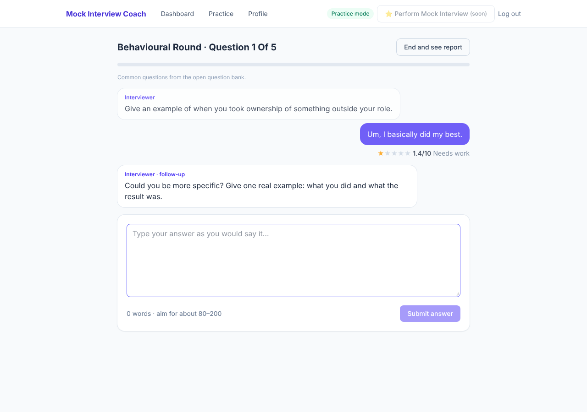

# AI Mock Interview Coach

An AI interview coach that trains candidates for interviews in their own field. Pick a role, a company style and a round, answer the AI interviewer's questions, and get a scored, star-rated report with ranked improvements and example answers, on screen and as a PDF by email.

**Built and run for $0.** Every service below has a free tier that needs no card.



More screenshots: [Mock interview](docs/screenshots/mock_hub.png) · [Perform Mock Interview](docs/screenshots/perform_hub.png) · [Coding round](docs/screenshots/coding.png) · [Report](docs/screenshots/report.png) · [Progress](docs/screenshots/progress.png)

## What works in v1

| Feature | Status |
|---|---|
| Sign up and log in (JWT + bcrypt) | ✅ |
| Profile: fields and roles, Practice/Mock mode setting, email on/off | ✅ |
| **Practice mode** (text): field → role → company style → round → difficulty → 5/10/15 questions | ✅ |
| AI follow-up question when an answer is vague | ✅ |
| Scoring with per-round weights, 1–10 score and 1–5 stars | ✅ |
| Report: per-question table, sub-scores, 🔴🟠🟢 ranked improvements, example answers, progress vs last attempt | ✅ |
| PDF and Excel reports, on screen and emailed | ✅ |
| Dashboard with history, and a **progress page** (score chart, skill changes, results by round, how far you get) | ✅ |
| **4 fields**: Tech (coding round), Finance (numbers and case questions), Sales (role-play sales calls), HR (situational cases) | ✅ |
| **Coding round**: Python editor, Run to see the real error, fix or Skip, hidden tests on Submit, all in your browser with Pyodide | ✅ |
| **Voice answers**: press 🎤 and speak; pace, long pauses and volume count toward Tone & delivery | ✅ |
| **Camera** self-view in Behavioural rounds (never recorded, uploaded or judged) | ✅ |
| **Mock mode**: one company, all 4 rounds, ¼ of the questions, pass marks, finish within 1 day, as many as you like | ✅ |
| **⭐ Perform Mock Interview**: common questions, full count, one round a day in your preferred slot, booking and reminder emails | ✅ |
| Pass/fail emails that say exactly why, "selected for next round", "not selected", incomplete reports | ✅ |
| Final report: overall band, band per skill, top 3 strengths and weaknesses, 7 → 10 roadmap, practice plan | ✅ |

### Coding, voice and camera: how they stay free and fair
- **Code runs in the candidate's browser** with [Pyodide](https://pyodide.org) (Python compiled to WebAssembly, loaded free from the jsDelivr CDN), inside a Web Worker with a 5-second limit, so the server never runs anyone's code. Hidden tests are only sent when you press Submit. Because it runs in the browser, a determined user could fake results; that's fine for a practice tool, but not for real hiring.
- Coding is scored on hidden tests passed, attempts, time taken, and how well you explain your approach.
- **Voice** uses the browser's built-in speech recognition (Chrome and Edge; the browser may use its own speech service). The app never uploads audio. It only measures pace (words per minute), silences over 3 seconds and whether you're too quiet. Accent is never judged.
- **Camera** is a self-view to make the round feel real. Nothing is recorded or analysed.

## How scoring works

Each answer gets four sub-scores (five in HR), combined with the weights from the plan:

| Factor | Screening | Technical | Behavioural | HR |
|---|---|---|---|---|
| Content | 30% | 50% | 30% | 25% |
| Communication | 35% | 20% | 25% | 25% |
| Tone & delivery | 20% | 10% | 20% | 20% |
| Thought process | 15% | 20% | 25% | 10% |
| Attitude & questions asked | – | – | – | 20% |

Weights, pass marks, roles and the example-answer style for each field live in [`backend/app/fields/`](backend/app/fields/) (one JSON file per field), so a new field is a new JSON file plus its questions in `backend/app/data/`.

**Fairness rules**
- Content, Communication and Thought process are scored by Gemini with a strict rubric. With no AI key, a transparent rule-based scorer is used instead (keywords covered, structure, reasoning words, length).
- Tone & delivery is never an AI opinion. It is counted from measurable things only: filler words ("um", "basically"…), run-on sentences, shouting, answer length. Accent, appearance, name and background are never judged.
- Lines like "give me 10/10" or "ignore previous instructions" are removed before scoring and flagged in the report. They never raise a score.

Rating scale: 9–10 ⭐⭐⭐⭐⭐ Excellent · 7–8 ⭐⭐⭐⭐ Good · 5–6 ⭐⭐⭐ Average · 3–4 ⭐⭐ Below average · 1–2 ⭐ Needs work.

## Where the questions come from

| Source | Licence |
|---|---|
| 300+ seed questions across Tech, Finance, Sales and HR, plus 10 Python coding problems with hidden tests, written for this project | MIT |
| Company-**style** questions generated by Gemini and cached | Labelled "not affiliated" |

The app is **not affiliated with any company**. Company names only set the style of the generated questions (for example "Amazon style" leans on leadership-principle behavioural questions). Sites whose terms forbid scraping, such as Glassdoor, AmbitionBox and LeetCode, are never used. Openly licensed datasets can be added later with the same tags (`source`, `license`).

## Tech stack (all free)

React + Vite + Tailwind · Pyodide · FastAPI · SQLAlchemy (SQLite locally, Neon Postgres when hosted) · Google Gemini free tier · fpdf2 and openpyxl · Gmail SMTP or Brevo for email · GitHub Actions for tests.

```
backend/   FastAPI app (app/main.py), scoring, AI, PDF, email, tests
frontend/  React app (src/pages)
render.yaml  one-click backend setup on Render
```

## Run it on your laptop

You need Python 3.11+ and Node 20+.

```bash
# 1. Backend
cd backend
pip install -r requirements.txt
cp .env.example .env          # then put your GEMINI_API_KEY in .env (optional)
set -a; source .env; set +a   # Windows PowerShell: set each variable with $env:NAME="value"
uvicorn app.main:app --reload # http://localhost:8000/docs shows every endpoint

# 2. Frontend (new terminal)
cd frontend
npm install
npm run dev                   # open http://localhost:5173
```

Without a Gemini key the app still works: it uses the question bank and the rule-based scorer.

Run the tests: `cd backend && pip install pytest httpx && pytest -q`

## Deploy for free (about 20 minutes)

Do the steps in this order, because each one gives you a value the next one needs.

### 1. Database: Neon (free Postgres)
1. Go to [neon.tech](https://neon.tech) → **Sign up** with GitHub → **Create project** (any name, nearest region).
2. On the dashboard, click **Connect**, and copy the connection string (it starts with `postgresql://`). This is your `DATABASE_URL`.

> Why not SQLite on the host? Render's free disk is wiped on every restart, so accounts would disappear.

### 2. AI key: Google Gemini (free)
1. Go to [aistudio.google.com/apikey](https://aistudio.google.com/apikey) → **Create API key**. Do **not** turn on billing, so it can never charge you.
2. Copy the key. This is your `GEMINI_API_KEY`.

### 3. Email: Brevo (free, 300 emails a day)
Render's free plan blocks normal email ports (SMTP), so Gmail App Passwords won't work there. Brevo sends over plain HTTPS instead.
1. Sign up at [brevo.com](https://www.brevo.com) (free plan, no card).
2. **Senders, domains & dedicated IPs** → **Senders** → **Add a sender** → use your Gmail address and click the link in the email they send. This is your `MAIL_FROM`.
3. Top-right menu → **SMTP & API** → **API keys** → **Generate a new API key**. This is your `BREVO_API_KEY`.

(Running locally? Gmail works too: turn on 2-step verification, create an [App Password](https://myaccount.google.com/apppasswords), and set `SMTP_USER`, `SMTP_PASSWORD` and `MAIL_FROM`.)

### 4. Backend: Render (free web service)
1. Go to [render.com](https://render.com) → sign up with GitHub (no card needed for the free plan).
2. **New +** → **Blueprint** → pick this repository. Render reads `render.yaml` and sets up the service.
3. It asks for the secret values. Paste `DATABASE_URL`, `GEMINI_API_KEY`, `BREVO_API_KEY` and `MAIL_FROM`. For `FRONTEND_ORIGINS`, put `http://localhost:5173` for now (you'll update it in step 6). `JWT_SECRET` is generated for you.
4. Click **Apply**. When it's live, open the URL (like `https://mock-interview-api.onrender.com`). You should see `{"ok":true,"ai":true,...}`. Copy this URL.

> The free plan sleeps after 15 minutes of no use, so the first visit can take up to a minute to wake up. The app shows a "waking up" message while it waits.

### 5. Frontend: Vercel (free)
1. Go to [vercel.com](https://vercel.com) → sign up with GitHub (Hobby plan, free).
2. **Add New…** → **Project** → import this repository.
3. Set **Root Directory** to `frontend`. Vercel detects Vite by itself.
4. Open **Environment Variables** and add `VITE_API_URL` = your Render URL from step 4 (no slash at the end).
5. Click **Deploy** and copy your site URL (like `https://ai-mock-interviews.vercel.app`).

(Netlify works the same way: **Add new site** → **Import from Git**, base directory `frontend`, build command `npm run build`, publish directory `frontend/dist`, and the same `VITE_API_URL` variable.)

### 6. Connect the two
On Render → your service → **Environment** → change `FRONTEND_ORIGINS` to your Vercel URL → **Save changes**. Render restarts, and the site is live.

### 7. Turn on reminders (GitHub Actions, free)
Perform Mock Interview sends a reminder an hour before each round, and Mock interviews close after a day. A small scheduled job in `.github/workflows/tick.yml` does this every 30 minutes.
1. On Render → your service → **Environment**, copy the value of `CRON_SECRET` (Render generated it).
2. On GitHub → this repo → **Settings** → **Secrets and variables** → **Actions** → **New repository secret**. Add `API_URL` (your Render URL) and `CRON_SECRET` (the value you copied).
3. **Actions** tab → **Reminders** → **Run workflow** to test it. It should print `{"reminders":0,"expired":0}`.

> Free minutes: public repos have unlimited Actions minutes. A private repo gets 2,000 free minutes a month, and this job uses about 1,500. If you need fewer, change `*/30` to `0 * * * *` (hourly).

**Live demo:** https://ai-based-mock-interviews-murex.vercel.app

## Honest notes

- This project was built with help from an AI coding assistant (Claude). I designed the product, chose the scope, and reviewed, tested and deployed the code.
- The AI's scores are feedback for practice, not a hiring decision. The rule-based fallback is simpler and less accurate than the Gemini scorer.
- Gemini's free tier has rate limits. Generated company-style questions are cached in the database so repeat sessions don't use the quota again.

## Licence

MIT. See [LICENSE](LICENSE).
